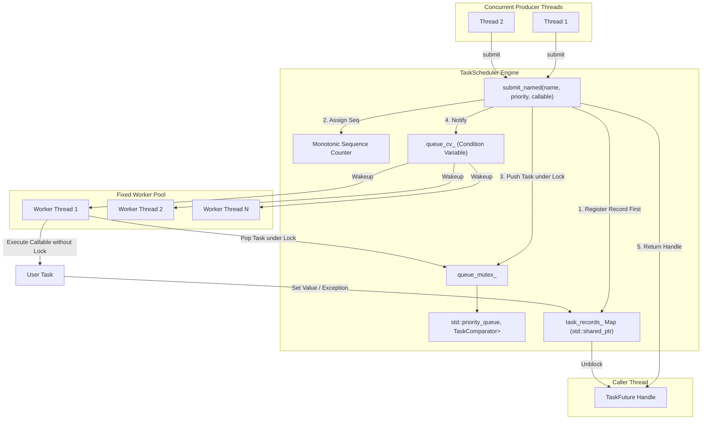
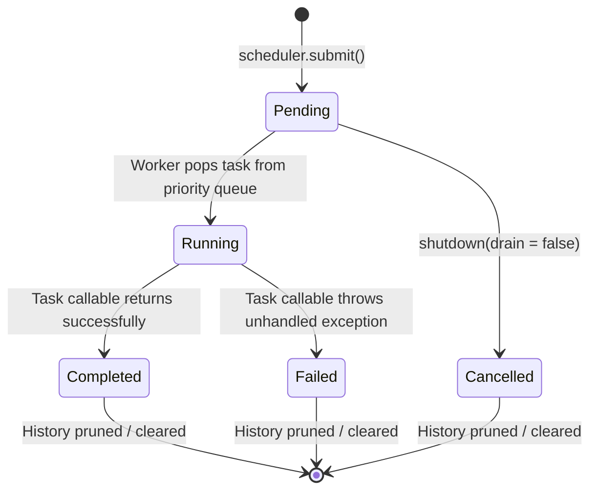

# ThreadForge ⚙️

[](https://github.com/shreysherikar/ThreadForge/actions/workflows/ci.yml)
[](https://en.wikipedia.org/wiki/C%2B%2B17)
[](LICENSE)

A multithreaded priority task scheduler engineered in Modern C++17. Designed to demonstrate systems programming, concurrency, STL data structures, RAII, exception safety, deterministic testing, and performance analysis.

---

## 1. Project Overview

**ThreadForge** is an asynchronous priority task execution engine built for systems where computational tasks carry varying urgency and unpredictable runtimes. It combines a thread-safe priority queue with a fixed pool of dedicated worker threads, guaranteeing strict weak ordering on execution priorities while maintaining deterministic First-In-First-Out (FIFO) tie-breaking for equal-priority workloads.

---

## 2. Motivation & Systems Relevance

Modern embedded systems, telemetry backends, robotics stacks, and real-time distributed controllers (such as automotive ECU units and consumer edge devices) require deterministic task dispatch without busy-waiting or thread exhaustion.

ThreadForge addresses core systems challenges:
- **Predictable Scheduling**: High-priority operations (e.g. safety triggers, telemetry) jump ahead of lower-priority background tasks.
- **Cache & Core Efficiency**: Avoids CPU spin-waits by utilizing predicate-based condition variable waits.
- **Exception Isolation**: Prevents unhandled exceptions from terminating worker threads or leaving futures dangling.
- **Coherent Lifecycle & Cancellation**: Distinguishes completed, failed, and cancelled tasks, ensuring every accepted task reaches a terminal state.
- **Coordinated Lifecycle**: Safely drains queues, serializes concurrent shutdowns, and detects worker self-joins.

---

## 3. Key Features

- **Prioritized Execution**: 4 discrete priority tiers (`Critical`, `High`, `Normal`, `Low`) with deterministic heap ordering.
- **Strict FIFO Tie-Breaking**: Atomic monotonic sequence numbers guarantee that tasks of equal priority execute in exact submission order.
- **Type-Erased Genericity**: Supports any callable returning typed results or `void`.
- **Explicit Cancellation Support**: Immediate shutdown (`shutdown(false)`) marks unstarted tasks as `Cancelled` and satisfies futures with `TaskCancelledException`.
- **RAII Task Handles (`TaskFuture<T>`)**: Wrapper around `std::future<T>` providing single-shot retrieval, non-blocking status queries, and timeout waits.
- **Thread-Safe Historical Registry**: Query status, timestamps, and error diagnostics by `TaskId` long after task completion.
- **Graceful Shutdown**: Drains accepted work, rejects new submissions, and ensures worker threads are joined on destruction.
- **Zero Raw Owning Pointers**: Built strictly using RAII, smart pointers (`std::shared_ptr`, `std::unique_ptr`), and atomics.
- **Zero Compiler Warnings**: Compiles cleanly with `-Wall -Wextra -Wpedantic` on GCC/Clang and `/W4` on MSVC.

---

## 4. Architecture Diagram



---

## 5. Build Requirements

- **C++ Compiler**: GCC 9+, Clang 10+, or MSVC 2019+ (Supporting C++17).
- **Build System**: CMake 3.16+ and Ninja or Make.
- **Unit Testing**: GoogleTest (automatically detected locally or fetched via CMake `FetchContent`).

---

## 6. Build Instructions

### Linux / macOS
```bash
# Clone the repository
git clone https://github.com/threadforge/threadforge.git
cd threadforge

# Configure Debug build
cmake -B build/debug -G Ninja -DCMAKE_BUILD_TYPE=Debug

# Compile core library, examples, tests, and benchmarks
cmake --build build/debug

# Run all 31 unit tests through CTest
ctest --test-dir build/debug --output-on-failure
```

### Windows (MSYS2 MinGW or MSVC)
```powershell
# Using Ninja and GCC/MSVC
cmake -B build/release -G Ninja -DCMAKE_BUILD_TYPE=Release
cmake --build build/release
ctest --test-dir build/release --output-on-failure
```

---

## 7. Example Applications

ThreadForge includes 5 compilable examples:

| Example | Binary | Description |
| :--- | :--- | :--- |
| **Basic Usage** | `example_basic_usage` | Typed results (`int`, `string`, `void`), task status, and scheduler statistics. |
| **Priority Scheduling** | `example_priority_scheduling` | Demonstrates Critical/High/Normal/Low dispatch order with FIFO tie-breaking. |
| **Concurrent Submission** | `example_concurrent_submission` | Multiple producer threads submitting hundreds of tasks simultaneously. |
| **Exception Handling** | `example_exception_handling` | Capturing and retrieving task exceptions without worker thread interruption. |
| **Graceful Shutdown** | `example_graceful_shutdown` | Draining active queues and rejecting post-shutdown submissions cleanly. |

Run an example:
```bash
./build/release/example_priority_scheduling
```

---

## 8. Task Lifecycle



---

## 9. Priority & FIFO Semantics

`std::priority_queue` is a max-heap where the element with highest precedence satisfies `Compare(top, other) == false`.

```cpp
struct TaskComparator {
    bool operator()(const Task& lhs, const Task& rhs) const noexcept {
        if (lhs.priority() != rhs.priority()) {
            return lhs.priority() < rhs.priority(); // Higher priority wins
        }
        return lhs.sequence_number() > rhs.sequence_number(); // Lower sequence number (earlier) wins
    }
};
```

> [!IMPORTANT]
> Priorities determine the order tasks are **dispatched** from the queue. Priorities do not preempt already running tasks and do not guarantee hard real-time deadlines.

---

## 10. Worker Synchronization & Thread Safety

- **Predicate-Based Condition Variable**: Workers wait via `queue_cv_.wait(lock, predicate)` to avoid lost and spurious wakeups.
- **Lock Scope Minimization**: Task callables are executed strictly **outside** `queue_mutex_` and `records_mutex_` (note: `task.cancel()` runs under `queue_mutex_` during non-draining shutdown).
- **Atomic Counters & Coherent Snapshots**: Gauges (`pending_tasks_`, `running_tasks_`) and cumulative counters (`completed_tasks_`, `failed_tasks_`, `cancelled_tasks_`) satisfy the fundamental invariant:
$$\text{total\_accepted} = \text{pending} + \text{running} + \text{completed} + \text{failed} + \text{cancelled}$$

Every state transition is synchronized under `queue_mutex_`, ensuring that snapshots taken via `get_stats()` remain coherent across threads.

---

## 11. Shutdown Contract

- `shutdown(drain = true)`: Atomically stops new submissions, allows running tasks to complete, drains all queued tasks, and joins workers.
- `shutdown(drain = false)`: Atomically stops new submissions, cancels unstarted queued tasks (marking them `Cancelled` and setting `TaskCancelledException`), and joins workers.
- **Idempotent**: Calling `shutdown()` repeatedly is safe.
- **Self-Join Detection**: Calling `shutdown()` or `wait_idle()` from inside a worker thread throws `std::logic_error`, avoiding self-join and self-wait deadlocks.

---

## 12. Benchmark Results

Measured in **Release mode** on an 8-core CPU (GCC 16, UCRT64, averaged over 3 repetitions):

```
=== ThreadForge Performance Benchmark Results (Averaged over 3 Repetitions) ===
Workload                  Tasks     Workers   Elapsed (ms)    Throughput (t/s)  Speedup     
--------------------------------------------------------------------------------------------
CPU Fine ~3us (Seq)       20000     1         60.48           330670.9          1.00        
CPU Fine ~3us (TF-1)      20000     1         110.90          180350.5          0.55        
CPU Fine ~3us (TF-N)      20000     8         301.61          66310.2           0.20        
CPU Med ~120us (Seq)      2000      1         248.09          8061.7            1.00        
CPU Med ~120us (TF-N)     2000      8         58.29           34308.6           4.26        
Sim-IO 1ms (Seq)          400       1         6430.60         62.2              1.00        
Sim-IO 1ms (TF-N)         400       8         815.91          490.3             7.88        
```

### Engineering Insights:
1. **Fine CPU Tasks (~3 µs)**: Demonstrates that microscopic tasks run faster sequentially. Thread synchronization and mutex contention dominate execution time.
2. **Medium CPU Tasks (~120 µs)**: Amortizes queue synchronization overhead, yielding **4.26x speedup** on 8 cores.
3. **Simulated I/O (Latency-Bound)**: Yields **7.88x speedup** on 8 cores, confirming near-linear scaling for I/O and waiting workloads.

---

## 13. Verification Status & Sanitizers

### What Is Verified:
- **Clean Compilations**: Builds cleanly under GCC 16.1.0 (MSYS2 UCRT64) with `-Wall -Wextra -Wpedantic` in both Debug and Release configurations.
- **Unit Testing**: 31 automated tests pass 100% across 6 CTest targets.
- **Examples**: All 5 example applications build and run with expected deterministic outputs.
- **Benchmarks**: Measured Release benchmarks with 3-run averaging across fine-grained, medium-grained, and I/O workloads.

### What Is NOT Run (Sanitizers on Windows MinGW):
- Sanitizers (`-fsanitize=address,undefined` and `-fsanitize=thread`) were **not run** in the local Windows MinGW-w64 environment because the MinGW-w64 GCC toolchain does not provide the requisite runtime libraries (`-lasan`, `-ltsan`) for Windows PE targets.
- Sanitizer configurations are integrated into the CMake build system and GitHub Actions CI workflow (`.github/workflows/ci.yml`) targeting Ubuntu Linux where sanitizer runtimes are standard.

---

## 14. Repository Structure

```
ThreadForge/
├── CMakeLists.txt              # Primary CMake build specification
├── CMakePresets.json           # Presets for Debug, Release, ASan, and TSan
├── README.md                   # Project documentation
├── LICENSE                     # MIT License
├── .gitignore                  # Git ignore rules
├── include/threadforge/
│   ├── task.hpp                # Task model, TaskRecord, TaskComparator, TaskFuture
│   ├── task_status.hpp         # TaskStatus enum and conversions
│   ├── task_priority.hpp       # TaskPriority enum and stream operators
│   ├── scheduler_stats.hpp     # Aggregate statistics snapshot
│   ├── task_scheduler.hpp      # TaskScheduler core facade
│   └── worker_pool.hpp         # Worker thread management and identification
├── src/
│   ├── task.cpp                # Translation unit
│   ├── task_scheduler.cpp      # Scheduler implementation
│   └── worker_pool.cpp         # WorkerPool implementation
├── examples/
│   ├── basic_usage.cpp
│   ├── priority_scheduling.cpp
│   ├── concurrent_submission.cpp
│   ├── exception_handling.cpp
│   └── graceful_shutdown.cpp
├── tests/
│   ├── test_task_scheduler.cpp
│   ├── test_priority_queue.cpp
│   ├── test_concurrency.cpp
│   ├── test_exception_handling.cpp
│   ├── test_shutdown.cpp
│   └── test_task_results.cpp
├── benchmarks/
│   └── scheduler_benchmark.cpp # Benchmark suite with CSV export & repetitions
├── docs/
│   ├── architecture.md         # Component ownership and lifecycle
│   ├── concurrency.md          # Mutexes, race conditions, and synchronization
│   ├── design_decisions.md     # Comparator design and trade-offs
│   └── testing.md              # Test strategy and synchronization
└── .github/
    └── workflows/
        └── ci.yml              # GitHub Actions CI matrix
```

---

## 15. License

ThreadForge is licensed under the [MIT License](LICENSE).
