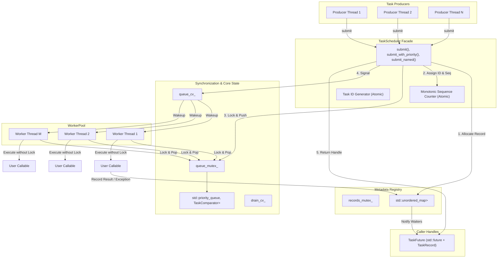
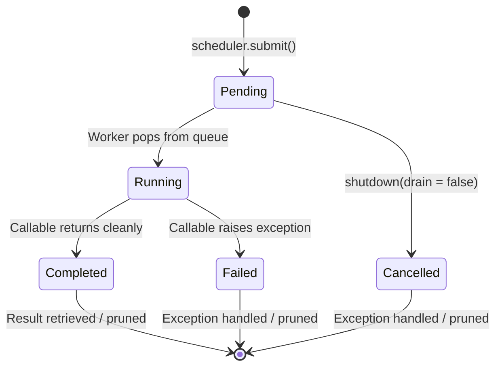

# Architecture Specification — ThreadForge

## 1. Architectural Overview

ThreadForge is a production-grade multithreaded priority task scheduler engineered in C++17. Its primary design goals are:
- **Deterministic priority execution** with strict FIFO tie-breaking for equal-priority tasks.
- **Robust concurrency control** with zero busy-waiting and explicit lock scope minimization.
- **Resilient exception boundaries** ensuring that worker threads never terminate from task exceptions.
- **Guaranteed graceful shutdown and cancellation** with worker self-join detection and clean queue draining.

---

## 2. Component Breakdown

### 2.1 Task & Metadata (`include/threadforge/task.hpp`)
- **`TaskRecord`**: Shared state allocated on heap via `std::shared_ptr`. Tracks immutable identity (`id`, `name`, `priority`, `sequence_number`), timestamps (`submission_time`, `start_time`, `finish_time`), atomic `TaskStatus`, stored `std::exception_ptr`, and a private condition variable/mutex for targeted task awaiting.
- **`Task`**: Lightweight, movable wrapper placed inside the priority queue. Stores a reference to `TaskRecord`, the primary callable `std::function<void()>`, and an explicit cancellation handler `std::function<void()>`.
- **`TaskComparator`**: Custom functor enforcing strict weak ordering on `Task` objects within `std::priority_queue`.
- **`TaskFuture<T>`**: Move-only RAII handle held by the caller, wrapping `std::future<T>` alongside `TaskId` and `TaskRecord`. Guarantees single-consumption semantics for `.get()`.

### 2.2 Worker Pool (`include/threadforge/worker_pool.hpp`)
- Manages an array of `std::thread` instances.
- Maintains an immutable set of worker `std::thread::id`s populated during initialization.
- Synchronizes startup via an atomic `start_flag_` member variable to guarantee thread IDs are recorded before any worker routine runs.
- Exposes `is_current_thread_worker()` to detect if the calling thread belongs to the pool.
- Exposes `join_all()` with idempotence guarantees to serialize thread joins.

### 2.3 TaskScheduler Facade (`include/threadforge/task_scheduler.hpp`)
- Main public interface coordinating task submission, priority queue synchronization, history pruning, statistics gathering, and graceful shutdown.
- Ensures atomic status inspection and lock-free gauges for real-time monitoring.

---

## 3. Task Lifecycle Semantics

Task transitions adhere to a strictly directed acyclic graph (DAG):

### Invariants:
1. Every accepted task reaches **exactly one** terminal state (`Completed`, `Failed`, or `Cancelled`).
2. `record->status` is published with `std::memory_order_release` before the `std::promise` is satisfied or `record->wait_cv` is notified.
3. No task ever transitions from a terminal state back to an active state.
4. Total accepted tasks strictly equals:
   $$\text{accepted} = \text{pending} + \text{running} + \text{completed} + \text{failed} + \text{cancelled}$$

---

## 4. Ownership and Lifetime Model

| Object | Owner | Lifetime |
| :--- | :--- | :--- |
| `TaskScheduler` | Client application | Scoped RAII or shared service |
| `WorkerPool` | `TaskScheduler` (`std::unique_ptr`) | Co-terminous with scheduler |
| `TaskRecord` | `task_records_` map + `Task` + `TaskFuture` | Extends until history is cleared AND future is dropped |
| `Task` | `std::priority_queue` | Enqueued in `submit()`, destroyed after worker pops or cancels |
| `std::thread` | `WorkerPool` (`std::vector<std::thread>`) | Joined before `WorkerPool` destruction |
