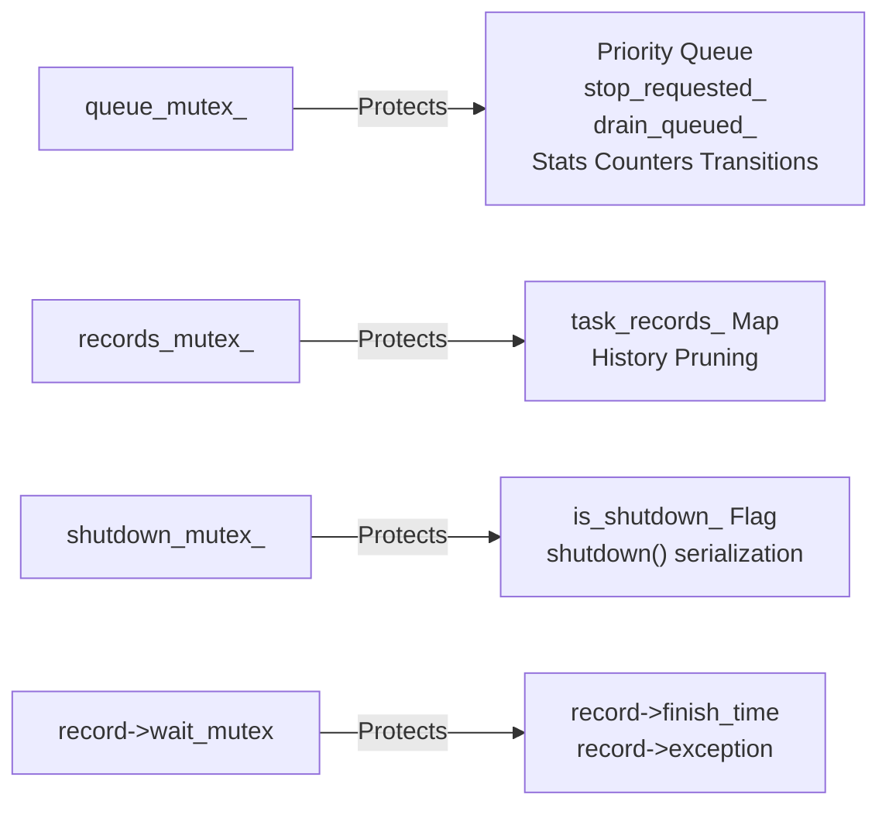
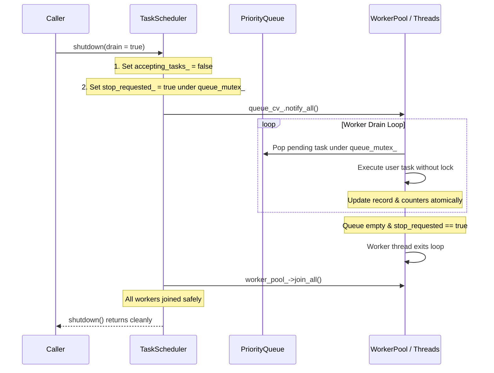

# Concurrency, Synchronization & Safety Guide — ThreadForge

## 1. Synchronization Architecture & Mutex Allocation

ThreadForge is built around distinct, unnested critical sections to minimize lock contention and eliminate lock-order deadlocks.

### Mutex Hierarchy & Isolation Rules:
1. **Never Nest Locks**: `queue_mutex_`, `records_mutex_`, and `shutdown_mutex_` are never held simultaneously in nested scopes.
2. **Never Execute User Code While Holding Internal Locks**: Worker threads acquire `queue_mutex_` solely to pop the next task, immediately release it, and only then invoke the task callable.
3. **Dedicated Record Mutexes**: Waiting for an individual task (`wait_for_task` or `record->wait_cv`) blocks on that task's private `wait_mutex`, completely decoupling task waiters from global scheduler throughput.
4. **Atomic Invariant Transitions**: In `execute_task`, transitioning a task from `running` to `completed`/`failed` is performed under `queue_mutex_` in the same critical section as decrementing `running_tasks_`. This guarantees that snapshots taken via `get_stats()` never observe a discrepancy between cumulative finished counts and active gauges.

---

## 2. Race Conditions & Deadlocks Analyzed

### 2.1 Worker-Thread Shutdown Deadlock Audit
- **Scenario Audited**:
  - Thread A calls `shutdown()` and holds `shutdown_mutex_` while joining worker threads.
  - A worker executing a user task calls `shutdown()` and blocks while trying to acquire `shutdown_mutex_`.
  - Thread A waits for the worker to exit, while the worker waits for Thread A to release `shutdown_mutex_`.
- **Why Deadlock Does NOT Occur**:
  - In `TaskScheduler::shutdown()`, `WorkerPool::is_current_thread_worker()` is checked **strictly before** acquiring `shutdown_mutex_`.
  - If the calling thread is a worker thread, it throws `std::logic_error` immediately without attempting to acquire `shutdown_mutex_`.
  - The worker catches the exception (or lets its execution wrapper catch it), finishes the task, and exits its worker loop, allowing Thread A's join to proceed cleanly.

### 2.2 Worker-Thread Wait-Idle Deadlock Audit
- **Scenario Audited**:
  - A task executing on a worker calls `scheduler.wait_idle()`.
  - `wait_idle()` waits for `running_tasks_ == 0`.
  - Since the calling worker is itself running, `running_tasks_` cannot reach 0.
- **Resolution**:
  - `wait_idle()` explicitly checks `is_current_thread_worker()` upon entry and immediately throws `std::logic_error`, preventing self-wait deadlocks.

### 2.3 The Promise-Status Publishing Race
- **Risk**: If `task_promise->set_value()` or `set_exception()` unblocks a caller thread before `record->status` is updated to `Completed` or `Failed`, the caller may immediately inspect `fut.status()` and see `Running`.
- **Solution**: Inside `execution_wrapper`, `record->status.store(..., std::memory_order_release)` is performed **strictly before** calling `task_promise->set_value()` or `task_promise->set_exception()`. This establishes a happens-before relationship between status publication and future unblocking.

### 2.4 Immediate Shutdown & Cancelled Promise Safety
- **Risk**: If unstarted tasks are removed from the priority queue without invoking their promises, destroying the promise objects causes `std::future_error (broken_promise)` to be thrown on caller futures.
- **Solution**: `Task` objects hold a cancellation handler. When `shutdown(false)` cancels pending tasks, it invokes `task.cancel()`, which sets `record->status = TaskStatus::Cancelled` and satisfies the promise with `TaskCancelledException`.

---

## 3. Worker Lifecycle & Graceful Drain Walkthrough

